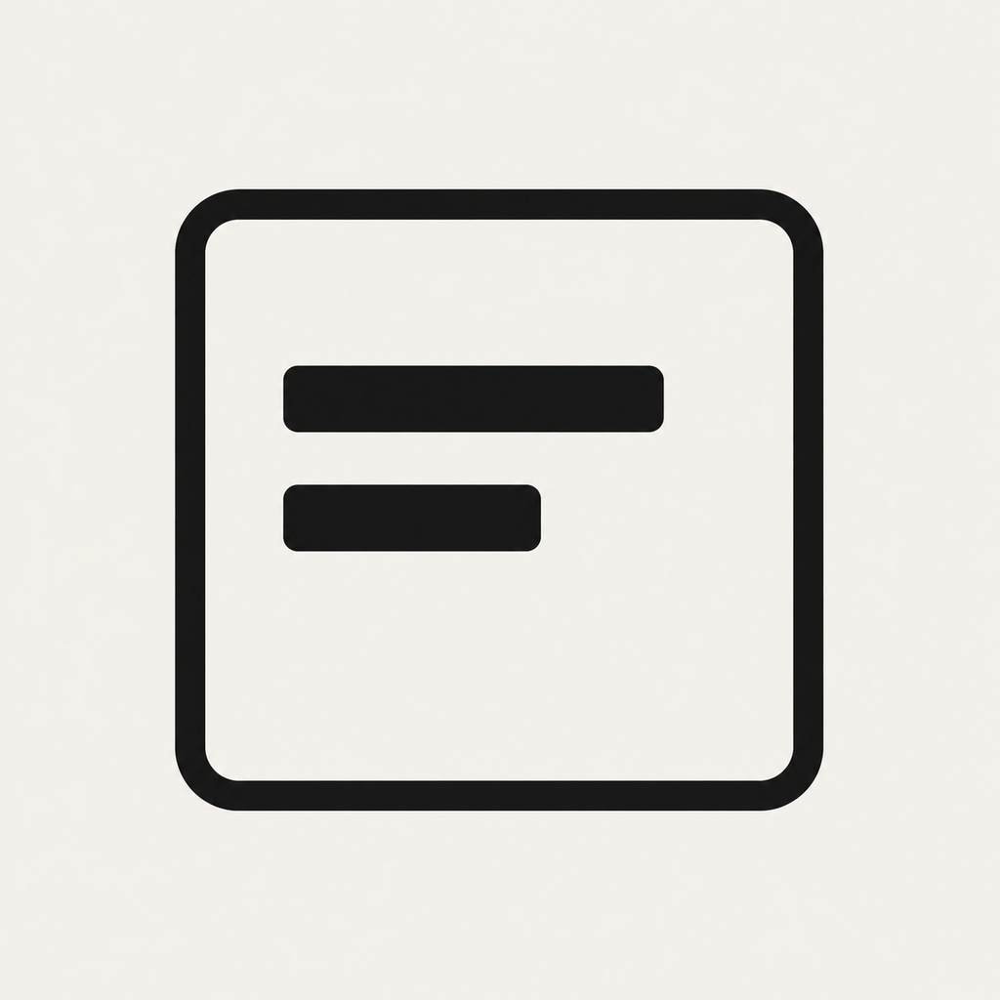
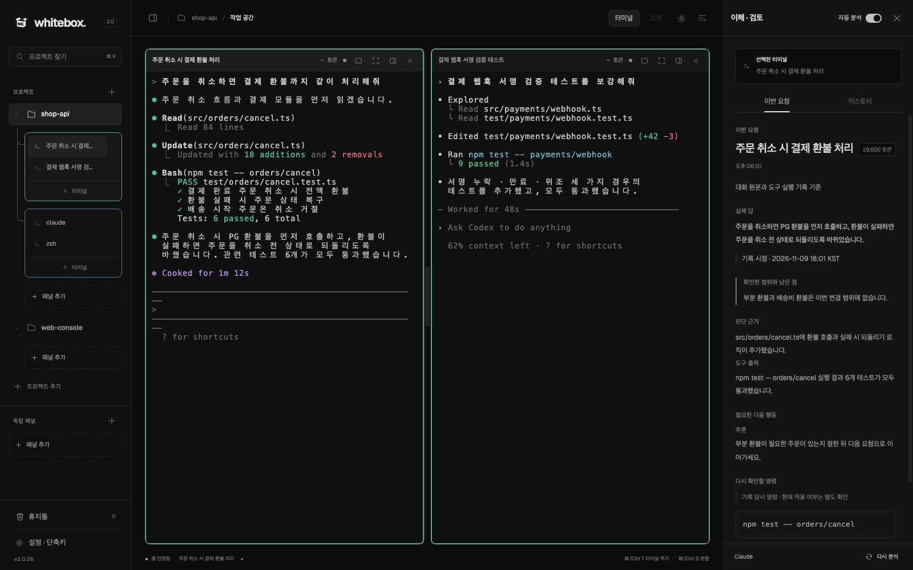
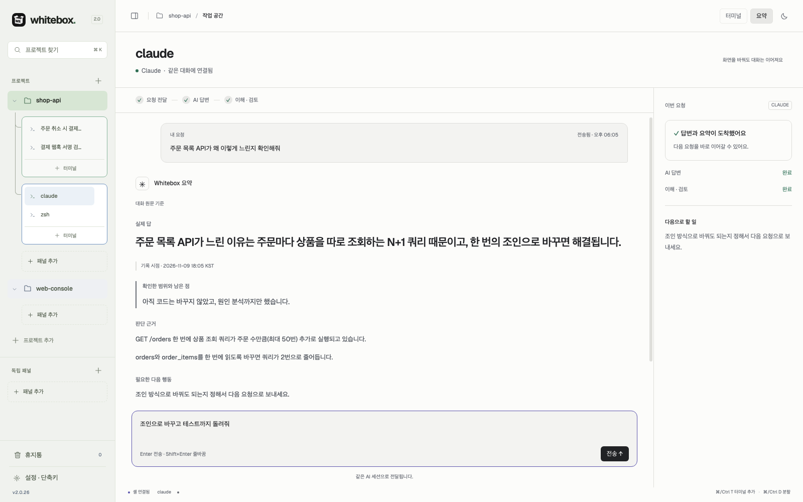
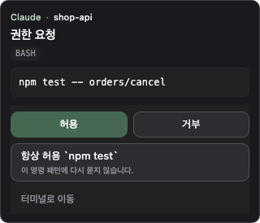
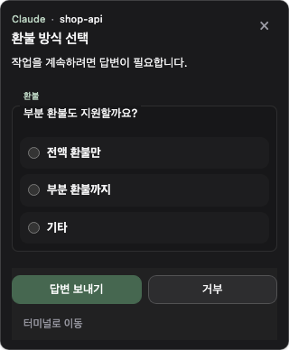
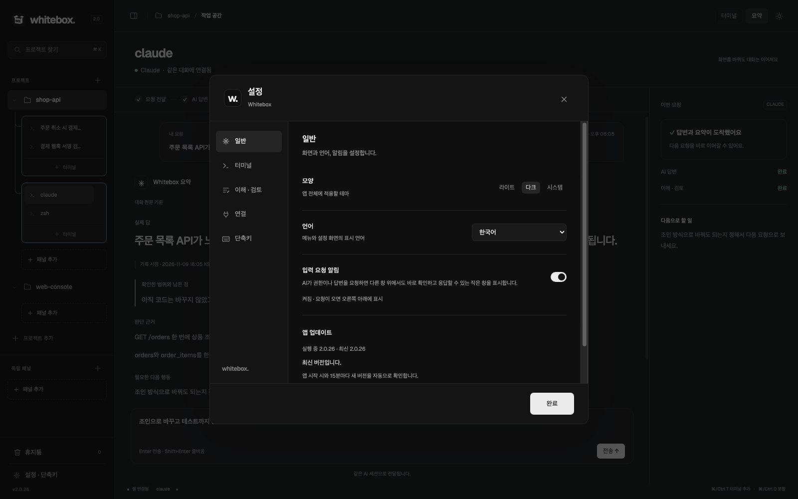

<p align="center">
  
</p>

<h1 align="center">Whitebox</h1>

<p align="center">
  <b>여러 AI 에이전트를 터미널에서 함께 돌리고,<br>각자 무엇을 했는지 바로 옆에서 확인하는 작업 공간</b>
</p>

<p align="center">
  <a href="https://github.com/minjund/Whitebox/releases/latest"></a>
  <a href="https://github.com/minjund/Whitebox/releases"></a>
  
  <a href="https://www.npmjs.com/package/whitebox-ai"></a>
  <a href="LICENSE"></a>
</p>

<p align="center">
  <a href="README.md">English</a> · <b>한국어</b> · <a href="README.zh-CN.md">简体中文</a>
</p>

<p align="center">
  <a href="#설치"><b>설치</b></a> ·
  <a href="#빠른-시작">빠른 시작</a> ·
  <a href="#주요-기능">주요 기능</a> ·
  <a href="#whitebox-cli">CLI</a> ·
  <a href="#개발">개발</a>
</p>

<p align="center">
  
</p>

## Whitebox는

Claude Code, Codex 같은 AI CLI를 여러 개 띄워 두면 어느 터미널이 무엇을 하고 있는지, 끝난 작업이 정말 요청대로 됐는지 놓치기 쉽습니다. Whitebox는 그 터미널들을 프로젝트별 패널로 묶어 보여 주고, 요청 하나하나에 대해 **실제로 한 일과 남은 일**을 터미널 옆에 정리해 줍니다.

- **터미널은 그대로입니다.** 평소 쓰던 CLI를 Whitebox 터미널에서 그대로 실행합니다. 별도 에이전트 프레임워크나 프롬프트 형식이 필요 없습니다.
- **요청 단위로 확인합니다.** 이해·검토는 그 결과를 만든 터미널과 요청에 붙어 있어, 여러 AI가 동시에 일해도 섞이지 않습니다.
- **로컬 데스크톱 앱입니다.** 터미널 출력과 기록은 내 컴퓨터에 저장됩니다. 분석에 쓰는 모델과 전송 범위는 [데이터와 개인정보](#데이터와-개인정보)에 정리했습니다.

## 설치

### Windows 10/11 (x64)

[Releases](https://github.com/minjund/Whitebox/releases/latest)에서 `Whitebox-Setup-*.exe`를 내려받아 실행합니다. NSIS 설치 프로그램에서 설치 대상을 현재 사용자로 고르면 사용자 영역에 설치되므로 관리자 권한이 필요하지 않습니다. 설치 폴더도 바꿀 수 있고, 이후 업데이트는 앱 안(설정 → 일반)에서 받을 수 있습니다. 설치 없이 실행하려면 `Whitebox-*-portable.exe`를 받으세요.

현재 Windows 설치 프로그램은 앱 업데이트 때 GitHub 릴리스에 기록된 크기와 SHA-256으로 내려받은 파일의 무결성을 검증하지만, Authenticode 코드 서명은 적용되지 않았습니다. 브라우저에서 내려받으면 Microsoft Defender SmartScreen이 알 수 없는 게시자 경고를 표시할 수 있습니다. 공식 [minjund/Whitebox Releases](https://github.com/minjund/Whitebox/releases) URL에서 받은 파일인지 확인한 뒤 **추가 정보 → 실행**을 누르세요.

### macOS

#### 설치 스크립트

```sh
curl -fsSL https://raw.githubusercontent.com/minjund/Whitebox/main/scripts/install-macos.sh | bash
```

최신 릴리스에서 이 Mac에 맞는 DMG(Apple Silicon은 `arm64`, Intel은 `x64`)를 내려받아 릴리스에 기록된 크기·SHA-256과 대조한 뒤 `/Applications/Whitebox.app`에 복사하고 quarantine 속성을 제거합니다. 위치를 바꾸려면 `WHITEBOX_INSTALL_DIR`를 지정:

```sh
curl -fsSL https://raw.githubusercontent.com/minjund/Whitebox/main/scripts/install-macos.sh \
  | WHITEBOX_INSTALL_DIR="$HOME/Applications" bash
```

#### 수동 DMG

[Releases](https://github.com/minjund/Whitebox/releases/latest)에서 `Whitebox-*-arm64.dmg`(Apple Silicon) 또는 `Whitebox-*-x64.dmg`(Intel)를 받아 Applications로 복사한 뒤 quarantine 속성 제거:

```sh
xattr -dr com.apple.quarantine /Applications/Whitebox.app
```

Whitebox는 Apple Developer ID로 서명·공증되지 않은 ad-hoc 빌드입니다. 위 명령은 Gatekeeper의 quarantine 플래그만 떼는 단계로 앱 무결성에는 영향이 없습니다.

### npm 실행기

Node.js 18 이상이 있다면 npm으로 설치하고 `whitebox` 명령으로 앱을 열 수 있습니다.

```sh
npm install -g whitebox-ai
whitebox
```

### 준비물

Whitebox는 AI CLI를 대신 설치하지 않습니다. 쓰려는 CLI([Claude Code](https://docs.anthropic.com/en/docs/claude-code), [Codex CLI](https://github.com/openai/codex) 등)를 먼저 설치하고 로그인해 두세요.

## 빠른 시작

1. 왼쪽 사이드바의 **프로젝트 추가**로 작업할 폴더를 엽니다.
2. **패널 추가**를 누르면 그 폴더에서 터미널 하나가 열립니다.
3. 터미널에서 `claude`나 `codex`를 실행하고 평소처럼 요청합니다.
4. 같은 패널에 **터미널**을 더하거나 <kbd>⌘/Ctrl</kbd>+<kbd>D</kbd>로 화면을 나눠 다른 AI를 함께 돌립니다.
5. 작업이 끝나면 오른쪽 **이해·검토**에서 요청한 일과 실제로 한 일, 남은 점을 확인합니다.

| 단축키 | 동작 |
| --- | --- |
| <kbd>⌘/Ctrl</kbd>+<kbd>T</kbd> | 터미널 추가 |
| <kbd>⌘/Ctrl</kbd>+<kbd>D</kbd> | 화면 분할 |
| <kbd>⌘/Ctrl</kbd>+<kbd>K</kbd> | 프로젝트 찾기 |

## 주요 기능

### 프로젝트 · 패널 · 분할 터미널

- 프로젝트마다 패널을 두고, 패널 안에서 터미널을 격자로 나눠 봅니다. 드래그로 다른 패널의 터미널과 함께 볼 수도 있습니다.
- 사이드바에서 터미널마다 작업 중, 입력·승인 대기, 아직 확인하지 않은 답변을 구분해 보여 줍니다. 오래 도는 백그라운드 명령과 감시(모니터) 작업은 따로 배지로 표시합니다.
- 터미널 이름은 마지막 요청의 요약으로 바뀌어, 여러 개를 열어도 어느 것이 무슨 일을 하는지 알 수 있습니다.
- 창 크기 변경, 패널 전환, 앱 재시작 뒤에도 터미널 세션과 출력이 유지됩니다. 한글 입력(IME)도 지원합니다.
- 휴지통으로 옮기면 세션을 멈추고 실행 한도를 비웁니다. 출력과 검토 기록은 남아 있어 읽기 전용으로 복원할 수 있고, 영구 삭제하면 기록도 지웁니다.

### 이해 · 검토

AI의 답변이 끝나면 그 요청에 대해 **실제 답, 확인한 범위와 남은 점, 판단 근거, 필요한 다음 행동**을 정리합니다. 대화 원문에서 온 내용과 도구 실행 기록에서 확인한 내용, 추론을 구분해 표시하고, 다시 확인할 명령은 그대로 복사할 수 있습니다. 지난 요청은 **히스토리** 탭에서 다시 볼 수 있습니다.

자동 분석은 오른쪽 위 스위치로 켜고 끕니다. 분석에 쓸 AI는 설정 → 이해·검토에서 **터미널과 같은 서비스**, Claude, Codex 중에서 고르고 모델도 정할 수 있습니다. 설정 → 연결에 Jev API 키를 넣으면 Jev가 분석이 필요한 요청만 먼저 골라 냅니다.

### 요약 모드

<p align="center">
  
</p>

터미널 화면 대신 요약된 답을 읽고, 같은 AI 세션에 다음 요청을 바로 보냅니다. 상단의 **터미널 / 요약**으로 언제든 전환하며, 터미널마다 보기 방식과 대화, 작성 중인 글을 따로 기억합니다.

- AI가 일하는 중에 보낸 요청은 대기열에 두었다가 답변이 끝나면 전달합니다. 보내기 전에 고치거나 취소할 수 있고, **그래도 전송하기**로 바로 전달할 수도 있습니다.
- 입력창에 `/`를 치면 그 AI의 슬래시 명령(기본 명령, 사용자 명령, 스킬, 플러그인 명령)을 고를 수 있습니다.
- 지원되는 승인 요청은 요약 화면에서 바로 답하고, **원래 답변 보기**로 터미널 원문을 엽니다.
- 요약을 기다리는 동안 2048을 할 수 있고, 설정 → 이해·검토에서 언제 쓸지 정할 수 있습니다.

### 질문 · 승인 팝업

<p align="center">
  
  &nbsp;&nbsp;
  
</p>

AI가 명령 실행 권한이나 답변을 요청하면 다른 창을 쓰고 있어도 화면 오른쪽 아래에 작은 창이 뜹니다. 그 자리에서 허용·거부하거나 답을 고르고, 질문이 여러 개면 페이지를 넘기며 답합니다. 응답은 원래 터미널과 요청인지 확인한 뒤에만 전달합니다.

### 터미널끼리 협업

Whitebox 터미널 안의 AI는 `whitebox` CLI나 패널 MCP 도구로 같은 패널에 새 AI 터미널을 열고, 다른 터미널에 요청을 보내고, 그 응답을 기다릴 수 있습니다. Whitebox 터미널에서는 tmux나 외부 터미널 앱을 여는 명령을 막고 Whitebox 도구를 쓰도록 안내합니다.

### 설정

<p align="center">
  
</p>

설정은 **일반**(테마, 언어, 입력 요청 알림, 앱 업데이트), **터미널**(글꼴, 글자 크기), **이해·검토**(자동 분석, 분석 서비스와 모델, 2048), **연결**(Codex · Claude 연결, Jev API 키), **단축키**로 나뉩니다. 화면 언어는 한국어, English, 简体中文을 지원합니다. 앱은 시작할 때와 15분마다 새 버전을 확인합니다.

## whitebox CLI

npm 실행기나 앱에 포함된 `whitebox` 명령으로 앱과 터미널을 다룰 수 있습니다.

```sh
whitebox                                        # 데스크톱 앱 열기
whitebox run claude                             # 앱 브리지에서 AI 실행 (claude | codex | gemini | grok)
whitebox new-terminal codex --count 3           # 같은 패널에 AI 터미널 3개 열기
whitebox list-panels                            # 같은 패널의 터미널 목록
whitebox ask codex "테스트 실패 원인 찾아줘"       # 다른 터미널에 요청 보내기
whitebox wait <job-id>                          # 그 요청의 실제 응답 기다리기
whitebox read-screen --surface <terminal-id>    # 터미널 출력 읽기
```

전체 명령은 `whitebox --help`로 확인합니다. `run`과 패널 명령은 Whitebox 앱이 열려 있어야 합니다.

## 데이터와 개인정보

- 터미널 출력, 요청, 검토 기록은 내 컴퓨터에만 저장합니다. 끝난 기록은 기본 30일 뒤 지우며, 보관 기간은 [데이터 보관](docs/DATA-RETENTION.md)에서 바꾸는 방법을 확인할 수 있습니다.
- 이해·검토와 요약은 고른 분석 서비스(Claude 또는 Codex)로 요청과 관련 작업 근거를 보냅니다. 해당 AI 계정의 사용량이 발생하며, 자동 분석은 언제든 끌 수 있습니다.
- Jev 선별을 켜면 요청과 관련 작업 기록을 TypeSafe로 보냅니다. 로컬 전용 분석이 아닙니다. Jev API 키는 메인 프로세스의 보호된 저장소에 보관합니다.
- 보안 취약점 신고는 [SECURITY.md](SECURITY.md)를 따라 주세요.

## 개발

Node.js 22 이상과 `node-pty` 빌드에 필요한 플랫폼 도구(macOS는 Xcode Command Line Tools, Windows는 Visual Studio Build Tools)가 필요합니다.

```sh
git clone https://github.com/minjund/Whitebox.git
cd Whitebox
npm ci
npm start
```

주요 검사:

```sh
npm run check:source      # 소스 규칙 검사
npm test                  # 회귀 테스트
npm run test:workspace    # 작업 공간 UI·터미널 통합 테스트
npm run test:terminal     # 터미널 엔진·PTY 테스트
```

구조는 [ARCHITECTURE.md](docs/ARCHITECTURE.md), 터미널 작업 공간 동작은 [terminal-workspace.md](docs/terminal-workspace.md), 릴리스 절차는 [RELEASING.md](docs/RELEASING.md)에 정리되어 있습니다. 기여 방법은 [CONTRIBUTING.md](CONTRIBUTING.md)를 참고하세요.

## 라이선스

Whitebox는 [MIT 라이선스](LICENSE)로 제공됩니다. 앱 아이콘 출처와 고지는 [ICON-LICENSE.md](docs/ICON-LICENSE.md)에 있습니다.

---

<p align="center">
  여러 AI를 동시에 쓰면서도 각각 무엇을 하는지 정확히 알고 싶은 사람을 위해 만들었습니다.
</p>
