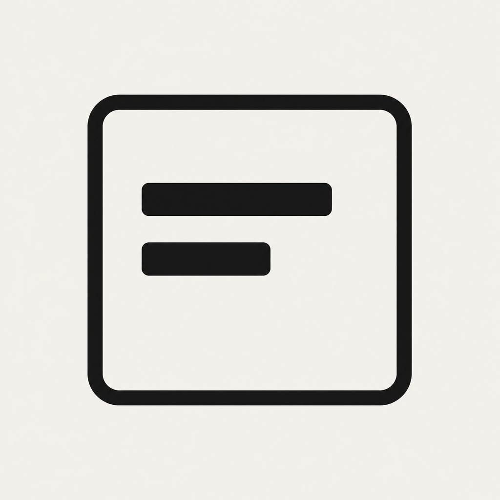
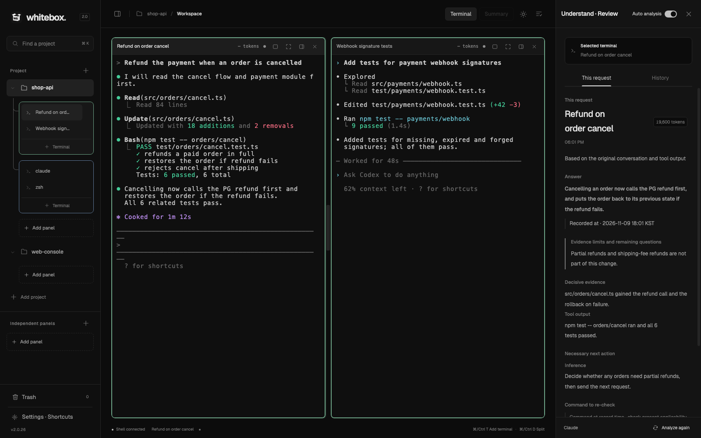
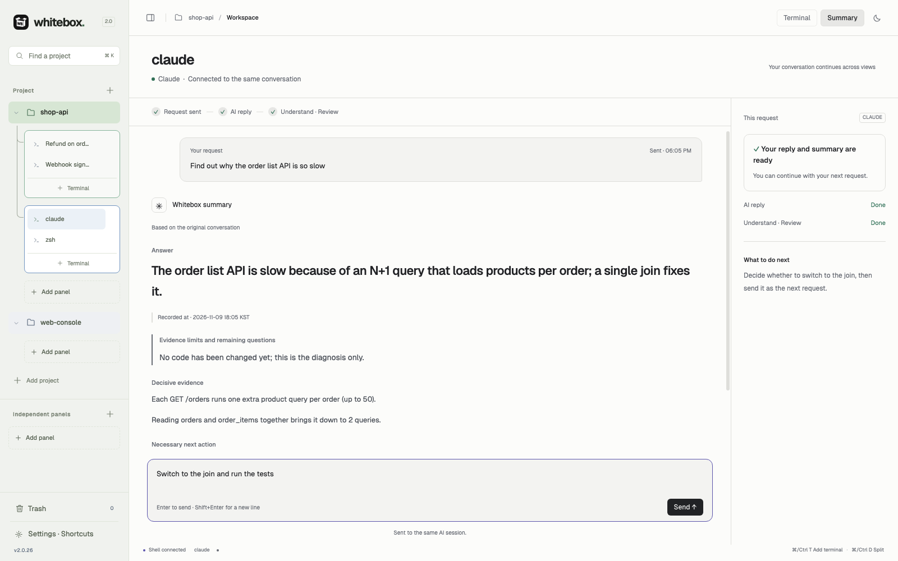
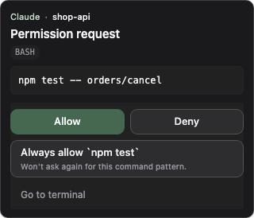
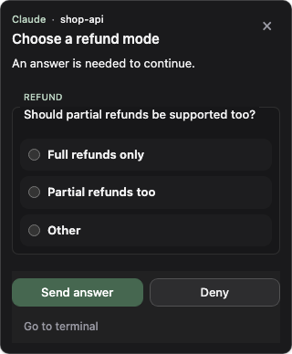
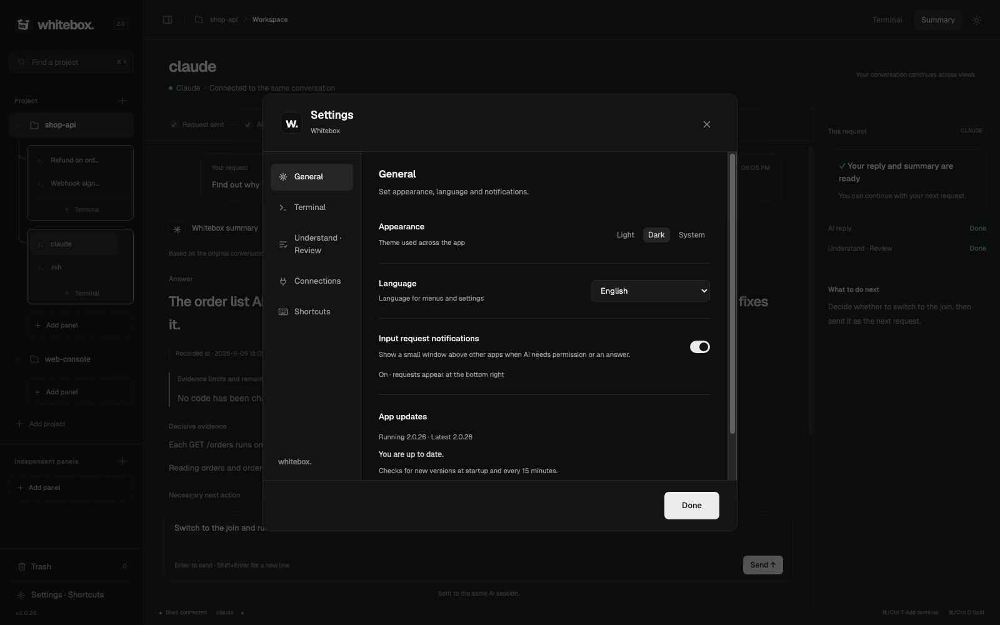

<p align="center">
  
</p>

<h1 align="center">Whitebox</h1>

<p align="center">
  <b>在真实终端中并行运行多个 AI 代理，<br>并在旁边看清每个代理到底做了什么。</b>
</p>

<p align="center">
  <a href="https://github.com/minjund/Whitebox/releases/latest"></a>
  <a href="https://github.com/minjund/Whitebox/releases"></a>
  
  <a href="https://www.npmjs.com/package/whitebox-ai"></a>
  <a href="LICENSE"></a>
</p>

<p align="center">
  <a href="README.md">English</a> · <a href="README.ko.md">한국어</a> · <b>简体中文</b>
</p>

<p align="center">
  <a href="#安装"><b>安装</b></a> ·
  <a href="#快速开始">快速开始</a> ·
  <a href="#主要功能">主要功能</a> ·
  <a href="#whitebox-cli">CLI</a> ·
  <a href="#开发">开发</a>
</p>

<p align="center">
  
</p>

> 截图使用英文界面。应用界面支持简体中文，可在 设置 → 常规 中切换语言。

## Whitebox 是什么

同时打开 Claude Code、Codex 等多个 AI CLI 时，很容易分不清哪个终端在做什么，也难以确认完成的任务是否真的按要求完成。Whitebox 按项目把这些终端组织成面板，并针对每个请求，在完成它的终端旁边列出**实际做了什么、还剩什么**。

- **终端还是原来的终端。** 在 Whitebox 终端里直接运行你常用的 CLI，无需额外的代理框架或提示格式。
- **按请求核对。** 每条审查都绑定到产生它的终端和请求，多个代理并行工作也不会混在一起。
- **本地桌面应用。** 终端输出和记录保存在你的电脑上。分析时会发送什么、发送到哪里，见[数据与隐私](#数据与隐私)。

## 安装

### Windows 10/11 (x64)

从 [Releases](https://github.com/minjund/Whitebox/releases/latest) 下载并运行 `Whitebox-Setup-*.exe`。在 NSIS 安装程序中选择仅为当前用户安装，即可安装到用户目录，无需管理员权限，也可以更改安装文件夹。之后可在应用内（设置 → 常规）更新。如果不想安装，请下载 `Whitebox-*-portable.exe`。

应用自更新时会用 GitHub Release 中记录的大小和 SHA-256 校验下载的文件，但 Windows 安装程序目前没有 Authenticode 代码签名。通过浏览器下载时，Microsoft Defender SmartScreen 可能提示未知发布者。请确认文件来自官方 [minjund/Whitebox Releases](https://github.com/minjund/Whitebox/releases) 地址，然后点击 **更多信息 → 仍要运行**。

### macOS

#### 安装脚本

```sh
curl -fsSL https://raw.githubusercontent.com/minjund/Whitebox/main/scripts/install-macos.sh | bash
```

从最新版本下载适合这台 Mac 的 DMG（Apple Silicon 为 `arm64`，Intel 为 `x64`），与 Release 中记录的大小和 SHA-256 核对后复制到 `/Applications/Whitebox.app`，并移除 quarantine 属性。如需更改位置，请设置 `WHITEBOX_INSTALL_DIR`：

```sh
curl -fsSL https://raw.githubusercontent.com/minjund/Whitebox/main/scripts/install-macos.sh \
  | WHITEBOX_INSTALL_DIR="$HOME/Applications" bash
```

#### 手动安装 DMG

从 [Releases](https://github.com/minjund/Whitebox/releases/latest) 下载 `Whitebox-*-arm64.dmg`（Apple Silicon）或 `Whitebox-*-x64.dmg`（Intel），复制到“应用程序”后移除 quarantine 属性：

```sh
xattr -dr com.apple.quarantine /Applications/Whitebox.app
```

Whitebox 是 ad-hoc 签名构建，没有使用 Apple Developer ID 签名和公证。上面的命令只移除 Gatekeeper 的 quarantine 标记，不会改动应用本身。

### npm 启动器

如果已安装 Node.js 18 或更高版本，可以用 npm 安装，并用 `whitebox` 命令打开应用。

```sh
npm install -g whitebox-ai
whitebox
```

### 前提条件

Whitebox 不会替你安装 AI CLI。请先安装并登录要使用的 CLI，例如 [Claude Code](https://docs.anthropic.com/en/docs/claude-code) 或 [Codex CLI](https://github.com/openai/codex)。

## 快速开始

1. 在左侧边栏点击 **添加项目**，选择一个文件夹。
2. 点击 **添加面板**，在该文件夹中打开一个终端。
3. 运行 `claude` 或 `codex`，像平常一样提出请求。
4. 在面板中再添加一个 **终端**，或用 <kbd>⌘/Ctrl</kbd>+<kbd>D</kbd> 分屏，同时运行另一个代理。
5. 回复完成后，在右侧 **理解 · 审查** 中查看你的请求、实际完成的工作和剩余事项。

| 快捷键 | 操作 |
| --- | --- |
| <kbd>⌘/Ctrl</kbd>+<kbd>T</kbd> | 添加终端 |
| <kbd>⌘/Ctrl</kbd>+<kbd>D</kbd> | 分屏 |
| <kbd>⌘/Ctrl</kbd>+<kbd>K</kbd> | 查找项目 |

## 主要功能

### 项目、面板与分屏终端

- 每个项目有自己的面板，面板内的终端按整齐的网格分屏。可以拖动终端，与其他面板的终端一起查看。
- 侧边栏区分正在工作的终端、等待输入或批准的终端，以及有未读回复的终端。长时间运行的后台命令和监视任务会显示单独的徽标。
- 终端名称会变为最近一次请求的摘要，打开很多终端也能一眼分清。
- 调整窗口大小、切换面板、重启应用后，终端会话和输出都会保留。支持中文、韩文等输入法。
- 移到回收站会停止会话并释放名额。输出和审查记录会保留，可只读恢复；永久删除会一并删除记录。

### 理解 · 审查

AI 回复完成后，Whitebox 会针对该请求列出**实际答案、已核实的范围与剩余问题、判断依据，以及需要的下一步**。来自对话原文的内容、由工具输出确认的结果和推断会分别标注，需要复查的命令可以直接复制。之前的请求保留在 **历史** 中。

用右上角的开关打开或关闭自动分析。在 设置 → 理解 · 审查 中选择用于分析的 AI（**与终端使用相同服务**、Claude 或 Codex）及其模型。在 设置 → 连接 中填入 Jev API 密钥后，Jev 会先挑出需要分析的请求。

### 摘要模式

<p align="center">
  
</p>

不看终端原文，而是阅读摘要后的回答，并把下一条请求直接发送到同一个 AI 会话。用顶部的 **终端 / 摘要** 随时切换；每个终端分别记住自己的视图、对话和草稿。

- AI 工作时发送的请求会进入队列，回复完成后再送达。发送前可以编辑或取消，也可以选择 **仍然发送** 立即送达。
- 在输入框输入 `/`，可以选择该 AI 的斜杠命令：内置命令、自定义命令、技能和插件命令。
- 支持的批准请求可以直接在摘要中回答，用 **查看原始回复** 打开终端原文。
- 等待摘要时可以玩 2048，并可在 设置 → 理解 · 审查 中设置何时可用。

### 提问与批准弹窗

<p align="center">
  
  &nbsp;&nbsp;
  
</p>

当 AI 请求执行命令的权限或需要你回答时，即使你正在使用其他应用，屏幕右下角也会出现一个小窗口。可以在那里允许、拒绝或选择答案；多个问题会分页显示。回复只有在确认对应原来的终端和请求后才会送达。

### 终端之间协作

Whitebox 终端中的 AI 可以通过 `whitebox` CLI 或面板 MCP 工具，在同一面板中打开更多 AI 终端、向其他终端发送请求并等待回复。在 Whitebox 终端中，打开 tmux 或外部终端应用的命令会被阻止，并引导改用 Whitebox 工具。

### 设置

<p align="center">
  
</p>

设置分为 **常规**（主题、语言、输入请求通知、应用更新）、**终端**（字体、字号）、**理解 · 审查**（自动分析、分析服务与模型、2048）、**连接**（Codex · Claude、Jev API 密钥）和 **快捷键**。界面支持 한국어、English 和 简体中文。应用会在启动时以及每 15 分钟检查一次新版本。

## whitebox CLI

`whitebox` 命令（来自 npm 启动器或随应用提供）可以控制应用及其终端。

```sh
whitebox                                        # 打开桌面应用
whitebox run claude                             # 通过应用桥接运行 AI（claude | codex | gemini | grok）
whitebox new-terminal codex --count 3           # 在同一面板打开 3 个 AI 终端
whitebox list-panels                            # 列出同一面板中的终端
whitebox ask codex "找出测试失败的原因"            # 向另一个终端发送请求
whitebox wait <job-id>                          # 等待该请求的实际回复
whitebox read-screen --surface <terminal-id>    # 读取终端输出
```

运行 `whitebox --help` 查看全部命令。`run` 和面板命令需要 Whitebox 应用处于打开状态。

## 数据与隐私

- 终端输出、请求和审查记录只保存在你的电脑上。已结束的记录默认 30 天后删除，修改方法见[数据保留](docs/DATA-RETENTION.md)。
- 理解 · 审查和摘要会把请求及相关工作依据发送给你选择的分析服务（Claude 或 Codex），会消耗该 AI 账户的用量；自动分析可随时关闭。
- 开启 Jev 筛选后，请求及相关工作记录会发送到 TypeSafe，这不是仅限本地的分析。Jev API 密钥保存在主进程受保护的密钥存储中。
- 安全问题请按 [SECURITY.md](SECURITY.md) 报告。

## 开发

需要 Node.js 22 或更高版本，以及 `node-pty` 所需的平台构建工具（macOS 为 Xcode Command Line Tools，Windows 为 Visual Studio Build Tools）。

```sh
git clone https://github.com/minjund/Whitebox.git
cd Whitebox
npm ci
npm start
```

主要检查：

```sh
npm run check:source      # 源码规则
npm test                  # 回归测试
npm run test:workspace    # 工作区界面与终端集成
npm run test:terminal     # 终端引擎与 PTY
```

结构见 [ARCHITECTURE.md](docs/ARCHITECTURE.md)，工作区行为见 [terminal-workspace.md](docs/terminal-workspace.md)，发布流程见 [RELEASING.md](docs/RELEASING.md)。提交拉取请求前请阅读 [CONTRIBUTING.md](CONTRIBUTING.md)。

## 许可证

Whitebox 以 [MIT 许可证](LICENSE) 提供。图标来源与声明见 [ICON-LICENSE.md](docs/ICON-LICENSE.md)。

---

<p align="center">
  为同时使用多个 AI、又想准确知道每个 AI 在做什么的人而做。
</p>
